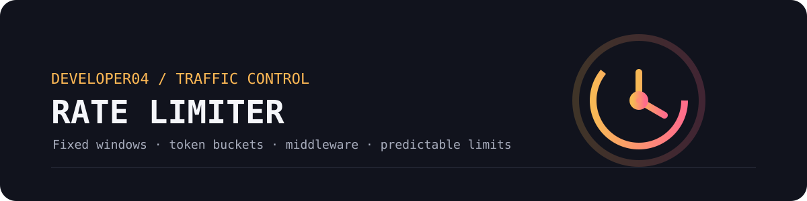

<p align="center"></p>

# D04 Rate Limiter

A zero-dependency rate-limiting library for Node.js services. Choose a fixed-window counter for simple quotas or a token bucket for smoother traffic shaping.

## Features
- Fixed-window limiter with reset timestamps
- Token-bucket limiter with continuous refill
- Express-compatible middleware adapter
- Per-key isolation and manual stale-entry cleanup
- Injectable clock for deterministic tests
- Node.js 20+; no runtime dependencies

## Token bucket
```js
import { TokenBucketLimiter } from "d04-rate-limiter";
const limiter = new TokenBucketLimiter({ capacity: 20, refillPerSecond: 2 });
const result = limiter.consume("user:42");
if (!result.allowed) console.log("Retry in", result.retryAfterMs, "ms");
```

## Fixed-window quota
```js
import { FixedWindowLimiter } from "d04-rate-limiter";
const quota = new FixedWindowLimiter({ limit: 100, windowMs: 60_000 });
const result = quota.consume("api-key:abc");
console.log(result.allowed, result.remaining, new Date(result.resetAt));
```

## Express middleware
```js
import express from "express";
import { FixedWindowLimiter, rateLimitMiddleware } from "d04-rate-limiter";
const app = express();
const limiter = new FixedWindowLimiter({ limit: 60, windowMs: 60_000 });
app.use("/api", rateLimitMiddleware(limiter, (req) => req.get("x-api-key") ?? req.ip));
```

The adapter returns HTTP 429 and a `Retry-After` header when a quota is exceeded. Supply a trusted identity function; do not trust arbitrary client IP headers unless your proxy validates them.

## API
| Export | Description |
| --- | --- |
| `FixedWindowLimiter` | Counter reset at a fixed interval |
| `TokenBucketLimiter` | Refillable burst-capacity bucket |
| `rateLimitMiddleware(limiter, keyFor)` | Express-compatible adapter |

## Operations
The built-in stores are process-local. For multiple server instances, use a shared atomic store such as Redis. Call `prune()` periodically when key cardinality is high.

## Tests
```bash
npm test
```

## License
MIT
